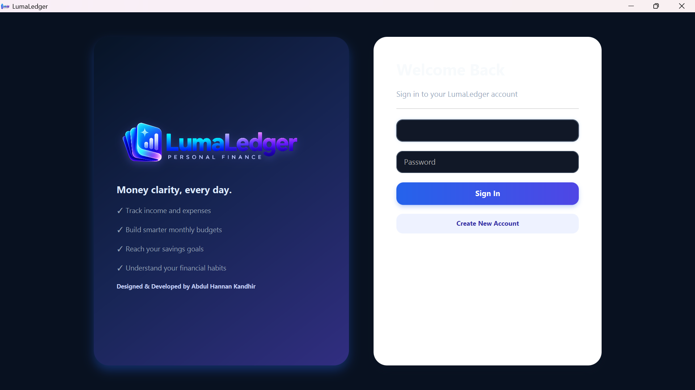
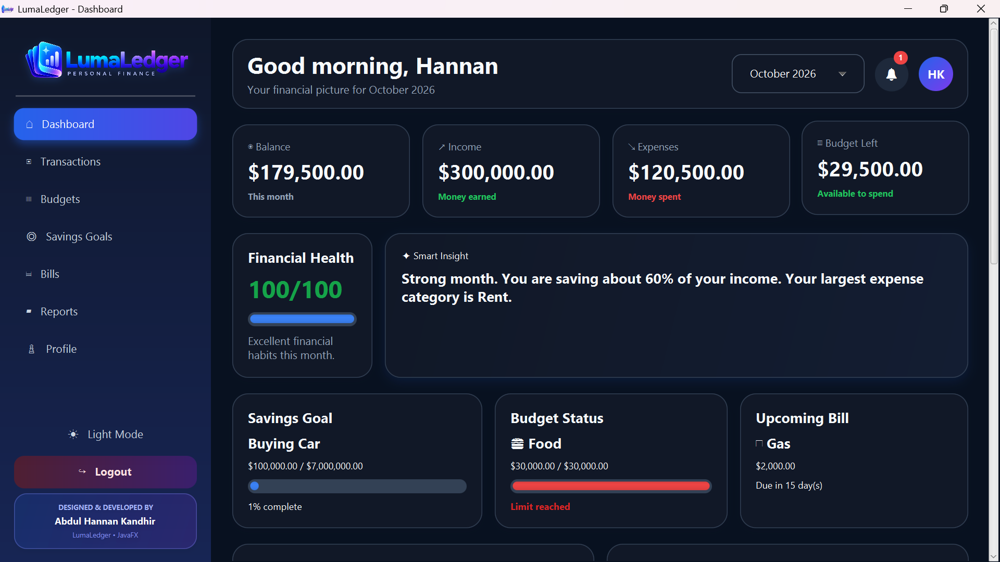

# 💎 LumaLedger

<p align="center">
  <b>A modern personal finance manager built with JavaFX.</b>
</p>

<p align="center">
  Track your income, expenses, budgets, savings goals, bills, and financial progress from one clean desktop application.
</p>

---

## 📥 Download LumaLedger

### Windows

Download the latest Windows installer:

[⬇️ Download LumaLedger v1.0.0](https://github.com/HannanKandhir/LumaLedger/releases/latest)

No Java installation is required for normal users.  
LumaLedger includes its own Java runtime.

---

## ✨ Features

- 💰 Track income and expenses
- 📊 Monthly financial dashboard
- 💳 Budget management
- 🎯 Savings goals
- 🧾 Recurring bill tracking
- 📈 Financial reports and charts
- 🧠 Smart monthly financial insights
- ❤️ Financial Health Score
- 🌙 Dark mode
- ☀️ Light mode
- 🔔 Budget and bill notifications
- ✏️ Edit and delete transactions
- 📅 Monthly transaction filtering
- 📤 Export transactions to CSV
- 💱 Currency preference
- 👤 User profile management
- 🔐 Secure password hashing
- 🔑 Password change support
- 💾 Local user data storage
- 🖥️ Standalone Windows application

---

## 🖼️ Application Preview

### Login Screen



### Dashboard



### Dashboard Overview


---

## 🚀 Installation

1. Open the **Releases** section of this repository.
2. Download:

```text
LumaLedger-1.0.0.exe
